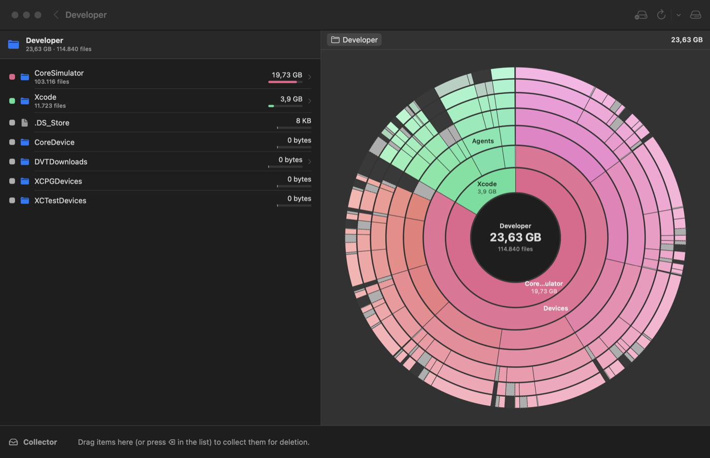
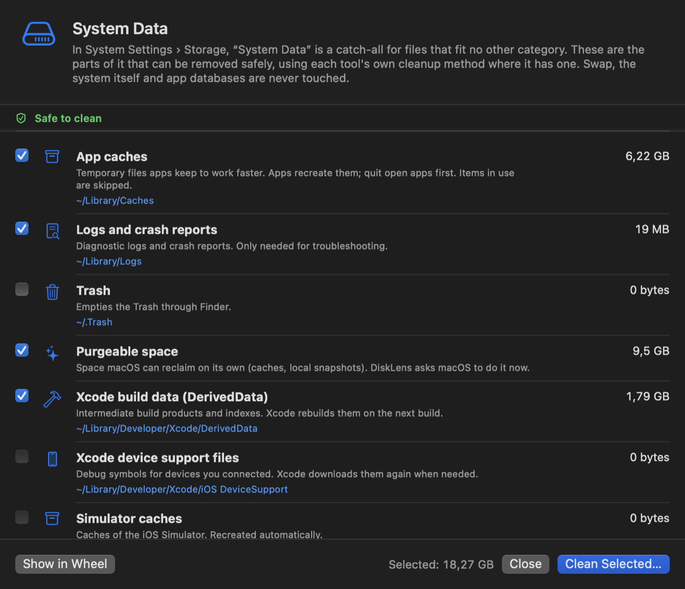
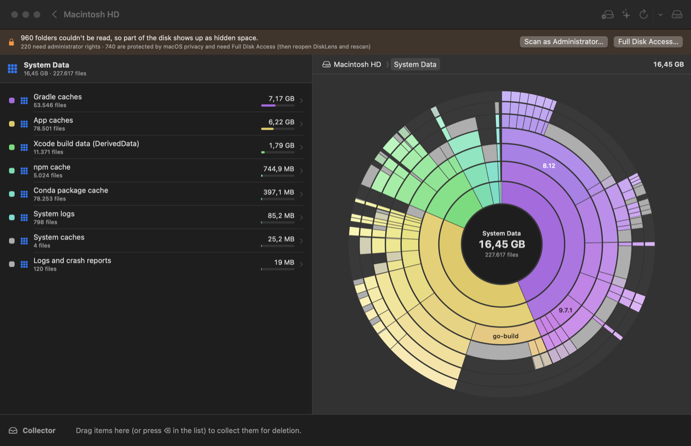
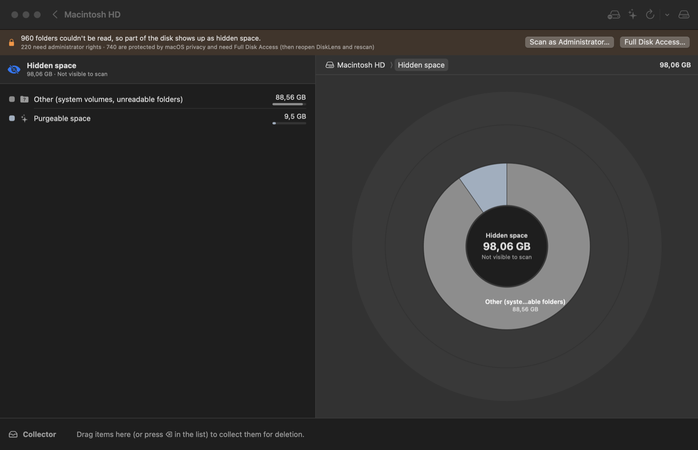
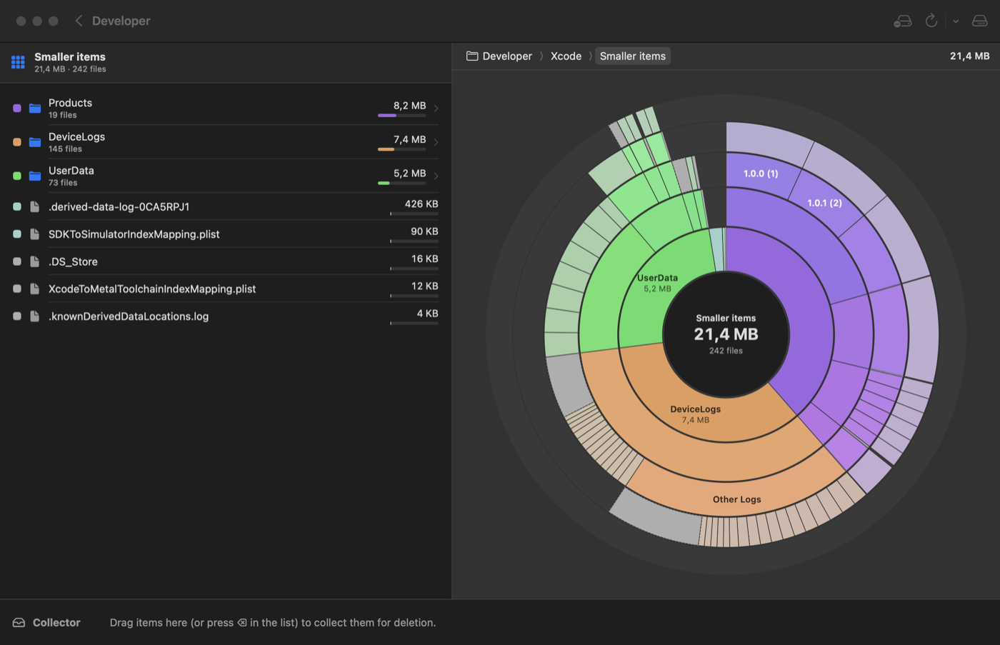

<div align="center">

# DiskLens

**Free, open-source disk space analyzer for macOS — see what fills your Mac and clean it safely.**<br>
**macOS için ücretsiz, açık kaynak disk alanı analiz aracı — Mac'inizi neyin doldurduğunu görün, güvenle temizleyin.**

[English](#english) · [Türkçe](#türkçe)




</div>

---

## English

DiskLens scans a disk or folder and draws everything on it as an interactive **sunburst chart**. The biggest folders and files stand out right away. Click to zoom in, drag what you don't need to the Collector, and delete it. It also explains and cleans macOS **"System Data"**: the mysterious gray bar in *System Settings › General › Storage*.

A free and open-source alternative to **DaisyDisk**, **GrandPerspective**, **OmniDiskSweeper** and **Disk Inventory X**. Native Swift / AppKit, no tracking, no account, no subscription.

### Features

- **Fast parallel scanner:** about 200,000 files/s on an SSD; 4 million files on a full disk in about 20 seconds. It uses `getattrlistbulk`, so each system call returns many directory entries.
- **Accurate sizes:**
  - Counts size *on disk* (compressed and sparse files show what they really occupy).
  - Hard links and **APFS clones** are counted once.
  - iCloud files are never downloaded just to measure them.
- **Interactive sunburst wheel:**
  - Labels inside slices, plus animated zoom-in / zoom-out.
  - Tiny files merge into one "Smaller items" slice that you can open.
  - The wheel fills in live while the scan runs.
- **System Data cleanup:** each item shows its size and a safety level.
  - **Safe:** app caches, logs, Xcode DerivedData, device support files, simulator caches, unavailable simulators, npm cache, Mail downloads, Trash, purgeable space.
  - **Review first:** Gradle caches, Conda packages, Time Machine local snapshots, system caches and logs, Xcode archives, iPhone/iPad backups, old macOS installers.
  - **How it cleans:** each tool's own supported command where one exists (`tmutil`, `xcrun simctl delete unavailable`, `conda clean --all`, Finder's Empty Trash). Anything you might want back goes to the Trash.
  - **Never offered:** swap, `/System` and app databases. Items macOS protects are left in place.
- **Hidden space explained:** used space that no scan can see is split into APFS snapshots (each measured), purgeable space and the rest.
- **Free purgeable space** on demand.
- **Scan as Administrator:** fills in folders your user can't read. Folders protected by macOS privacy controls are flagged separately; those need Full Disk Access instead.
- **Collector:** drag items in, then *Move to Trash*, *Delete Immediately* or *Delete as Administrator*.
- **Live updates:** FSEvents keeps the results current, and you can rescan a single folder.
- **Disk list:** shows used / purgeable / free space and the disk type (SSD / HDD / network). Spinning disks are scanned sequentially to avoid seek thrashing.
- **Cloud drives:** iCloud Drive, Google Drive, Dropbox, OneDrive and Box folders, with files that live only in the cloud shown faded.
- **Everyday tools:** Quick Look (Space), Reveal in Finder, keyboard navigation.
- **Languages:** English and Turkish.

### Screenshots

| System Data cleanup | System Data as a wheel |
|---|---|
|  |  |
| **Hidden space breakdown** | **Smaller items, opened** |
|  |  |

### Install / build

Requirements: macOS 15 or later and Xcode 16 or later (Swift 6).

```sh
git clone https://github.com/yusatll/disklens.git
cd disklens
scripts/build-app.sh          # universal app → build/DiskLens.app
open build/DiskLens.app
```

To see everything, give DiskLens **Full Disk Access** (*System Settings › Privacy & Security › Full Disk Access*), then reopen it and rescan. Without it, the folders macOS protects show up as hidden space.

The build is ad-hoc signed. macOS may ask you to confirm the first launch: right-click the app and choose **Open**.

### Usage tips

| Action | How |
|---|---|
| Zoom into a folder | Click its slice, or double-click it in the list |
| Go up | Click the center, ⌘↑, or the breadcrumbs |
| Collect for deletion | Drag a slice or row to the Collector, or press ⌫ |
| Preview a file | Space (Quick Look) |
| Clean System Data | Sidebar card, toolbar button, or ⇧⌘K |
| Rescan | ⌘R (everything) / ⇧⌘R (current folder) |

### How it works

| Part | Implementation |
|---|---|
| Scanner | `getattrlistbulk` on a worker pool, one task per directory; sizes are summed bottom-up as directories finish, so there is no second pass |
| Deduplication | Hard links by `(device, file ID)`; APFS clones by `ATTR_CMNEXT_CLONEID` |
| iCloud safety | `setiopolicy_np(IOPOL_TYPE_VFS_MATERIALIZE_DATALESS_FILES, OFF)` on each scan thread |
| Wheel | `NSBezierPath` annular sectors; hit-testing by radius → ring and angle → binary search |
| Hidden space | `NSURL` volume capacity keys, `fs_snapshot_list` + APFS snapshot size `fsctl`, CoreServices purgeable estimate |
| Admin tasks | The app runs itself as root (`--privileged <request>`) through the standard macOS password dialog; only `scan`, `delete` and snapshot commands are accepted |
| Live updates | FSEvents; changed folders are re-listed, and already scanned subfolders are kept |

```
Sources/DiskLensCore/   scanner, tree model, layout, snapshots, purge, System Data, privileged helper (unit tested)
Sources/DiskLens/       AppKit + SwiftUI app
scripts/                build-app.sh, release.sh (Developer ID + notarization), icon and localization tools
```

Run the tests with `swift test`.

**Note:** purgeable space and snapshot sizes use undocumented macOS interfaces that are looked up at runtime. If a future macOS removes them, those features hide themselves instead of crashing.

### Contributing

Issues and pull requests are welcome. Translations live in `scripts/translations_tr.py`; regenerate them with `python3 scripts/generate-localizations.py`.

---

## Türkçe

DiskLens bir diski ya da klasörü tarar ve içindeki her şeyi etkileşimli bir **güneş patlaması (sunburst) grafiğinde** gösterir. En büyük klasörler ve dosyalar hemen göze çarpar. Tıklayıp içine girin, gereksizleri Toplayıcı'ya sürükleyin ve silin. Ayrıca *Sistem Ayarları › Genel › Depolama*'daki o gizemli gri **"Sistem Verileri"** alanının ne olduğunu açıklar ve güvenle temizler.

**DaisyDisk**, **GrandPerspective**, **OmniDiskSweeper** ve **Disk Inventory X** için ücretsiz, açık kaynak bir alternatif. Yerel Swift / AppKit ile yazıldı. Takip yok, hesap yok, abonelik yok.

### Özellikler

- **Hızlı paralel tarama:** SSD'de saniyede yaklaşık 200.000 dosya; tam disk (4 milyon dosya) yaklaşık 20 saniye. `getattrlistbulk` kullanır; tek sistem çağrısı birçok klasör girdisini birden döndürür.
- **Doğru boyutlar:**
  - Diskte gerçekten kaplanan alan sayılır (sıkıştırılmış ve seyrek dosyalar dahil).
  - Sabit bağlantılar (hard link) ve **APFS klonları** bir kez sayılır.
  - iCloud dosyaları ölçmek için asla indirilmez.
- **Etkileşimli çark:**
  - Dilimlerin içinde ad ve boyut etiketleri, animasyonlu yakınlaştırma / uzaklaştırma.
  - Çok küçük dosyalar tek bir "Küçük öğeler" diliminde toplanır; bu dilim açılabilir.
  - Tarama sürerken çark canlı olarak dolar.
- **Sistem Verileri temizliği:** her öğe boyutu ve güvenlik düzeyiyle gösterilir.
  - **Güvenle temizlenebilir:** uygulama önbellekleri, günlükler, Xcode DerivedData, cihaz destek dosyaları, simülatör önbellekleri, kullanılamayan simülatörler, npm önbelleği, Mail ekleri, Çöp Sepeti, boşaltılabilir alan.
  - **Önce gözden geçirin:** Gradle önbellekleri, Conda paketleri, Time Machine yerel snapshot'ları, sistem önbellekleri ve günlükleri, Xcode arşivleri, iPhone/iPad yedekleri, eski macOS yükleyicileri.
  - **Nasıl temizler:** mümkün olan her yerde aracın kendi komutuyla (`tmutil`, `xcrun simctl delete unavailable`, `conda clean --all`, Finder'ın Çöp Sepeti'ni Boşalt komutu). Geri isteyebileceğiniz şeyler Çöp Sepeti'ne gider.
  - **Asla önerilmez:** takas (swap) dosyaları, `/System` ve uygulama veritabanları. macOS'in koruduğu öğeler yerinde bırakılır.
- **Gizli alan açıklaması:** hiçbir taramanın göremediği kullanılan alan; APFS snapshot'ları (her biri ölçülerek), boşaltılabilir alan ve kalan kısım olarak ayrılır.
- **Boşaltılabilir alanı** istendiğinde boşaltma.
- **Yönetici olarak tarama:** kullanıcınızın okuyamadığı klasörleri tamamlar. macOS gizlilik korumasındaki klasörler ayrıca işaretlenir; onlar için Tam Disk Erişimi gerekir.
- **Toplayıcı:** öğeleri sürükleyip *Çöp Sepeti'ne Taşı*, *Hemen Sil* ya da *Yönetici Olarak Sil*.
- **Canlı güncelleme:** FSEvents sonuçları güncel tutar; tek bir klasör de yeniden taranabilir.
- **Disk listesi:** kullanılan / boşaltılabilir / boş alanı ve disk türünü (SSD / HDD / ağ) gösterir. Mekanik diskler kafa hareketini azaltmak için sırayla taranır.
- **Bulut sürücüleri:** iCloud Drive, Google Drive, Dropbox, OneDrive ve Box klasörleri. Yalnızca bulutta duran dosyalar soluk gösterilir.
- **Günlük araçlar:** Hızlı Bakış (Boşluk tuşu), Finder'da Göster, klavyeyle gezinme.
- **Diller:** Türkçe ve İngilizce.

### Kurulum / derleme

Gereksinimler: macOS 15 veya üstü ve Xcode 16 veya üstü (Swift 6).

```sh
git clone https://github.com/yusatll/disklens.git
cd disklens
scripts/build-app.sh          # evrensel uygulama → build/DiskLens.app
open build/DiskLens.app
```

Her şeyi görmek için DiskLens'e **Tam Disk Erişimi** verin (*Sistem Ayarları › Gizlilik ve Güvenlik › Tam Disk Erişimi*), sonra uygulamayı yeniden açıp tekrar tarayın. Bu izin olmadan macOS'in koruduğu klasörler gizli alan olarak görünür.

Derleme ad-hoc imzalıdır. İlk açılışta macOS onay isteyebilir: uygulamaya sağ tıklayıp **Aç**'ı seçin.

### Kullanım ipuçları

| İşlem | Nasıl |
|---|---|
| Klasörün içine girmek | Dilimine tıklayın ya da listede çift tıklayın |
| Üst klasöre çıkmak | Ortaya tıklayın, ⌘↑ veya yol çubuğu |
| Silmek için toplamak | Dilimi ya da satırı Toplayıcı'ya sürükleyin veya ⌫ tuşuna basın |
| Dosyayı önizlemek | Boşluk tuşu (Hızlı Bakış) |
| Sistem Verilerini temizlemek | Kenar çubuğundaki kart, araç çubuğu düğmesi ya da ⇧⌘K |
| Yeniden taramak | ⌘R (tümü) / ⇧⌘R (geçerli klasör) |

### Katkı

Hata bildirimleri ve pull request'ler memnuniyetle karşılanır. Türkçe çeviriler `scripts/translations_tr.py` dosyasında; değişiklikten sonra `python3 scripts/generate-localizations.py` ile yeniden oluşturun.

---

<sub>Keywords: macOS disk space analyzer, disk usage, storage analyzer, Mac cleaner, System Data cleanup, free up space on Mac, sunburst chart, DaisyDisk alternative, GrandPerspective alternative, open source · Anahtar kelimeler: Mac disk analizi, disk alanı, depolama analizi, Sistem Verileri temizleme, Mac temizleme, yer açma, açık kaynak</sub>

## License / Lisans

[MIT](LICENSE) © Ahmet Yuşa Telli
